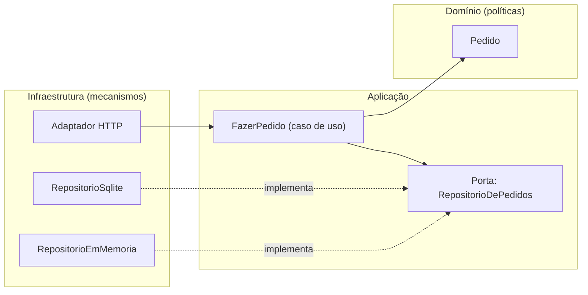

# Camadas, Hexagonal, Onion e Clean: a Dependency Rule

> "Source code dependencies can only point inwards. Nothing in an inner circle can know
> anything at all about something in an outer circle."
> Robert C. Martin, *The Clean Architecture*

| | |
|---|---|
| **Origem** | Layered (Eric Evans, 2003), Hexagonal (Alistair Cockburn, 2005), Onion (Jeffrey Palermo, 2008), Clean (Robert C. Martin, 2012) |
| **Resolve** | Regra de negócio que só roda com banco, framework e UI ligados, e que quebra quando qualquer um deles muda |
| **Em uma frase** | As dependências de código apontam para a regra de negócio, nunca o contrário; a infraestrutura é um detalhe plugável |

## O problema

Em [`ruim.py`](ruim.py), `Pedido.confirmar()` valida, abre uma conexão SQLite e "envia" um
e-mail. A regra de negócio (pedido não pode ser vazio) está presa a mecanismos: para
testá-la é preciso um arquivo de banco e um servidor de e-mail, e trocar o banco exige
editar a classe que guarda a regra. Palermo descreve o mesmo sintoma na arquitetura em
camadas tradicional: "each layer is coupled to the layers below it, and each layer is
often coupled to various infrastructure concerns", e o pior ofensor é "the coupling of UI
and business logic to data access".

## A solução

Quatro nomes, uma ideia. Todas as variantes querem **separar a política (regra de negócio)
dos mecanismos (banco, web, filas)**; o que muda é o desenho e a ênfase.

| Variante | Quando e quem | O que acrescenta |
|---|---|---|
| **Layered** | Evans, *Domain-Driven Design* (2003) | Isolar o modelo de domínio em uma camada própria, separada de UI, aplicação e infraestrutura. No livro, cada camada depende só das camadas abaixo |
| **Hexagonal** (Ports & Adapters) | Cockburn, artigo de 2005-09-04 | A assimetria relevante é **dentro × fora**, não cima × baixo. Porta = conversa com propósito; adaptador = tradução para uma tecnologia. A intenção: a aplicação pode ser guiada por usuários, programas, testes ou *batch* e desenvolvida em isolamento de dispositivos e bancos reais |
| **Onion** | Palermo, 2008-07-29 | Modelo de domínio no centro e todo o acoplamento voltado para o centro; interfaces de repositório no anel de dentro, implementações na borda |
| **Clean** | Martin, 2012-08-13 | Unifica as anteriores sob a **Dependency Rule** e nomeia os círculos (entidades, casos de uso, adaptadores de interface, frameworks) |

A diferença prática entre o Layered clássico e as outras três está na **direção de uma
seta**: no Layered, o domínio depende da camada de persistência que está abaixo dele; nas
outras, a persistência depende do domínio, porque implementa uma interface que o domínio
(ou a aplicação) define. É a inversão de dependência (DIP) aplicada à arquitetura inteira.

Em [`bom.py`](bom.py):

| Círculo | Código | Conhece |
|---|---|---|
| Domínio | `Pedido` | nada além de Python |
| Aplicação | `FazerPedido`, portas `RepositorioDePedidos` e `Notificador` | domínio |
| Infraestrutura | `RepositorioSqlite`, `RepositorioEmMemoria` | portas e domínio |

O teste [`test_camadas_hexagonal_clean.py`](test_camadas_hexagonal_clean.py) prova a regra
de duas formas: examina a árvore sintática (`ast`) para garantir que `Pedido` e
`FazerPedido` não mencionam `sqlite3`, e roda o mesmo caso de uso com um adaptador em
memória e com SQLite sem alterá-lo. O teste da versão ruim mostra o contrário: a regra
"conhece" o banco e só roda tocando em arquivo.

## Quando não aplicar

- **CRUD simples e sites pequenos.** Palermo avisa no texto original que a Onion
  "is not appropriate for small websites"; ela serve a "long-lived business applications as
  well as applications with complex behavior". Sem regra de negócio relevante, portas,
  repositórios e casos de uso são cerimônia.
- **Não crie uma porta para cada coisa.** Cockburn nota que o hexágono não implica seis
  lados nem um número fixo de portas; separe o que realmente varia (banco, gateway de
  pagamento, relógio), não toda classe.
- **Os círculos são esquemáticos.** Martin escreve que você pode precisar de mais ou menos
  que quatro; a regra, não a quantidade de camadas, é o que importa.

## Relações

- **DIP** (princípios SOLID) é o mecanismo; a Dependency Rule é o DIP aplicado às fronteiras
  do sistema.
- **DDD** fornece o que fica no centro: veja [`../ddd`](../ddd/README.md).
- **Fakes** em memória dos adaptadores são o que torna o teste do caso de uso rápido; veja
  [`../../04-testes/dubles-de-teste`](../../04-testes/dubles-de-teste/README.md).
- Em tensão com **KISS/YAGNI** quando usada em sistemas que não têm complexidade para pagá-la.

## Referências

- Robert C. Martin, [*The Clean Architecture*](https://blog.cleancoder.com/uncle-bob/2012/08/13/the-clean-architecture.html), 2012.
- Alistair Cockburn, [*Hexagonal Architecture*](https://alistair.cockburn.us/hexagonal-architecture), 2005.
- Jeffrey Palermo, [*The Onion Architecture: part 1*](https://jeffreypalermo.com/2008/07/the-onion-architecture-part-1/), 2008.
- Eric Evans, [*Domain-Driven Design: Tackling Complexity in the Heart of Software*](https://www.dddcommunity.org/book/evans_2003/), 2003; resumo dos padrões em [*DDD Reference*](https://www.domainlanguage.com/ddd/reference/) (seção Layered Architecture).
