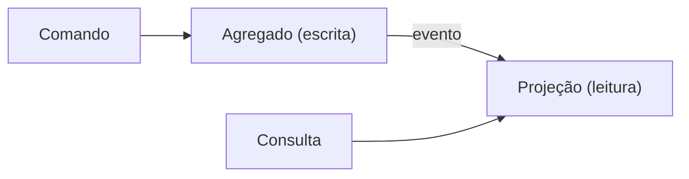

# CQRS: Command Query Responsibility Segregation

> "At its heart is the notion that you can use a different model to update information than
> the model you use to read information."
> Martin Fowler, *CQRS*

| | |
|---|---|
| **Origem** | Greg Young, a partir do CQS de Bertrand Meyer; descrito por Fowler em 2011 |
| **Resolve** | Modelo único que serve mal à escrita (invariantes) e à leitura (consultas e telas) |
| **Em uma frase** | Use um modelo para alterar o estado e outro, otimizado, para consultá-lo |

## O problema

Em [`ruim.py`](ruim.py), listar quanto cada cliente gastou obriga a carregar cada agregado
`Pedido` completo e somar em memória. O modelo de escrita, desenhado para proteger
invariantes, é usado como se fosse um modelo de relatório: o custo cresce com o número de
pedidos e o domínio acaba deformado para atender telas.

## A solução

Em [`bom.py`](bom.py):

| Papel | Código | Responsabilidade |
|---|---|---|
| **Comando** | `FazerPedido` | passa pelo agregado, valida invariantes, publica o evento |
| **Evento** | `PedidoFeito` | fato ocorrido |
| **Projeção** (read model) | `TotalPorCliente` | já guarda o total pronto, atualizado pelo evento |
| **Consulta** | `total_do_cliente` | lê a projeção; não toca em agregado |

O [`test_cqrs.py`](test_cqrs.py) mostra o ganho (a consulta não carrega agregados, enquanto
a versão ruim carrega um por pedido), que a invariante continua protegida e que a projeção
pode ser reconstruída reaplicando os eventos.

O custo está escondido no exemplo: aqui a projeção é atualizada na mesma chamada. Se escrita
e leitura usam armazenamentos distintos, a leitura fica **eventualmente consistente** (o
usuário pode não ver o que acabou de gravar), e é preciso lidar com eventos perdidos,
duplicados e fora de ordem.

### Não confunda com CQS

**CQS** (Command-Query Separation, Meyer) é um princípio **de métodos**: um método ou
altera o estado (comando) ou devolve um valor (consulta), não ambos. **CQRS** separa
**modelos**, às vezes até armazenamentos. Dá para praticar CQS sem CQRS (e deve).

## Quando não aplicar

Fowler é direto: "for most systems CQRS adds risky complexity". Fique no modelo único
quando:

- o sistema é um CRUD, ou leitura e escrita têm formato e carga parecidos;
- você não consegue pagar a consistência eventual (UX, regras, equipe);
- a única motivação é "arquitetura moderna". Comece com consultas diretas (SQL de leitura
  sobre as mesmas tabelas) antes de separar modelos; isso já é uma forma leve de separar
  leitura e escrita.

CQRS combina com *event sourcing*, mas um não exige o outro, e event sourcing acrescenta
ainda mais complexidade.

## Relações

- Vive dentro de um Bounded Context: veja [`../ddd`](../ddd/README.md).
- O evento que alimenta a projeção é o mesmo mecanismo que, entre serviços, exige
  [idempotência](../../06-operabilidade/idempotencia/README.md): eventos podem chegar duas vezes.
- É um dos custos do "prêmio" de distribuição: veja
  [`../monolito-modular-vs-microsservicos`](../monolito-modular-vs-microsservicos/README.md).

## Referências

- Martin Fowler, [*CQRS*](https://martinfowler.com/bliki/CQRS.html), 2011.
- Martin Fowler, [*Command Query Separation*](https://martinfowler.com/bliki/CommandQuerySeparation.html), 2005.
