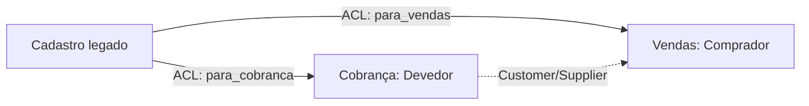

# DDD estratégico: Bounded Context, Ubiquitous Language e Context Map

> "Speak a ubiquitous language within an explicitly bounded context."
> Eric Evans, *DDD Reference*

| | |
|---|---|
| **Origem** | Eric Evans, *Domain-Driven Design: Tackling Complexity in the Heart of Software* (2003) |
| **Resolve** | Modelo único "da empresa" que ninguém entende por inteiro e que todo time quebra ao mexer |
| **Em uma frase** | Divida o domínio em contextos delimitados, cada um com seu modelo e sua linguagem, e declare como eles se relacionam |

## O problema

A palavra "cliente" não significa a mesma coisa em Vendas, Cobrança e Logística. Em
[`ruim.py`](ruim.py), uma única classe `Cliente` acumula o limite de crédito, os dias de
atraso e a janela de entrega para satisfazer todo mundo: qualquer time que a altera pode
quebrar os outros, e criar um cliente exige dados que o contexto de quem cria nem possui.
Martin Fowler descreve o mesmo problema: um modelo precisa ser internamente consistente, e
termos como "Customer" ou "Product" significam coisas distintas em partes diferentes da
organização.

## A solução

Os três conceitos estratégicos:

| Conceito | O que é |
|---|---|
| **Bounded Context** | Fronteira explícita dentro da qual um modelo e sua linguagem valem. Dentro dela o modelo é consistente; fora, o mesmo termo pode ter outro sentido |
| **Ubiquitous Language** | Vocabulário único, compartilhado por especialistas do negócio e programadores, usado na conversa **e** no código (nomes de classes, métodos, testes) dentro de um contexto |
| **Context Map** | Mapa das relações entre contextos e dos times que os mantêm |

Os padrões de relação do *DDD Reference* incluem **Shared Kernel**, **Customer/Supplier**,
**Conformist**, **Open Host Service / Published Language** e **Anticorruption Layer**. O
último é o que [`bom.py`](bom.py) usa: o sistema de cadastro legado entrega um
`CadastroExterno`, e as funções `para_vendas` e `para_cobranca` traduzem para o modelo de
cada contexto (`Comprador`, `Devedor`) na fronteira, de modo que o formato legado não vaza
para dentro dos modelos.

O teste [`test_ddd.py`](test_ddd.py) mostra que cada contexto só carrega os campos de que
precisa e que a mesma pessoa é "inadimplente" para Cobrança e "sem prazo" para Vendas:
dois vocabulários, um mesmo fato.

### E os padrões táticos?

Entity, Value Object, Aggregate, Repository, Domain Service e Domain Event são o lado
**tático** do DDD, dentro de um contexto. Eles não são repetidos aqui: o repositório
[DDD-Structure](https://github.com/LoboProgrammingg/DDD-Structure) é uma base executável em
Python (FastAPI, eventos de domínio, testes e CI) que mostra esses padrões funcionando. Do
lado tático, o anti-padrão a evitar é o **Anemic Domain Model** (Fowler, 2003): objetos de
domínio que só carregam dados, com toda a regra em serviços.

## Quando não aplicar

- **Domínio simples.** DDD é investimento em modelagem para domínios complexos; CRUD sem
  regras relevantes não precisa de contextos, agregados e linguagem ubíqua formal.
- **Um time, um conceito.** Se não há polissemia nem times diferentes mexendo no mesmo
  modelo, um contexto só basta. Fronteiras demais viram integração demais.
- **Sem acesso aos especialistas.** Linguagem ubíqua depende de conversar com quem conhece o
  negócio; sem isso, vira só renomear classes.

## Relações

- Cada Bounded Context é o candidato natural a módulo de um monólito modular ou a serviço:
  veja [`../monolito-modular-vs-microsservicos`](../monolito-modular-vs-microsservicos/README.md).
- O interior de um contexto costuma seguir a Dependency Rule:
  veja [`../camadas-hexagonal-clean`](../camadas-hexagonal-clean/README.md).
- A comunicação entre contextos é um bom lugar para eventos de domínio e para
  [testes de contrato](../../04-testes/testes-de-contrato/README.md).

## Referências

- Eric Evans, [*Domain-Driven Design*](https://www.dddcommunity.org/book/evans_2003/), 2003.
- Eric Evans, [*DDD Reference*](https://www.domainlanguage.com/ddd/reference/), 2015 (definições de Bounded Context, Ubiquitous Language e dos padrões de relação entre contextos).
- Martin Fowler, [*Bounded Context*](https://martinfowler.com/bliki/BoundedContext.html), 2014.
- Martin Fowler, [*Ubiquitous Language*](https://martinfowler.com/bliki/UbiquitousLanguage.html), 2006.
- Martin Fowler, [*Anemic Domain Model*](https://martinfowler.com/bliki/AnemicDomainModel.html), 2003.
- Matheus Lobo, [DDD-Structure](https://github.com/LoboProgrammingg/DDD-Structure): referência executável dos padrões táticos.
