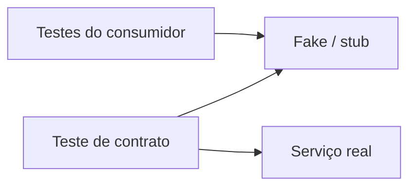

# Testes de contrato

> "Contract tests... check that all the calls against your test doubles return the same
> results as a call to the external service would."
> Martin Fowler, *Contract Test*

| | |
|---|---|
| **Origem** | Martin Fowler, *Contract Test* (2011); Pact para contratos dirigidos pelo consumidor |
| **Resolve** | O dublê de um serviço externo envelhece; os testes continuam verdes e a integração quebra em produção |
| **Em uma frase** | Verifique, com a mesma suíte, que o dublê e o serviço real respondem do jeito que o consumidor espera |

## O problema

Em [`ruim.py`](ruim.py), o consumidor `ClienteDeCep` foi testado contra um stub que responde
`logradouro` e `cidade`. O serviço real passou a responder `street` e `city`. Os testes do
consumidor continuam **verdes** (o stub é imutável), e em produção o código levanta
`KeyError`. Os testes só provam que o consumidor funciona com a *lembrança* que o autor
tem do serviço.

Fowler descreve a armadilha: um dublê da dependência externa é útil, mas "what happens if
the external service changes its contract?".

## A solução

Escreva o contrato como código e rode **o mesmo teste** contra os dois lados. Em
[`bom.py`](bom.py):

- `CONTRATO` lista os campos e tipos de que o consumidor depende;
- `violacoes(resposta)` aponta o que falta ou tem tipo errado;
- o contrato roda contra `ProvedorFake` (usado nos testes do consumidor) **e** contra
  `ProvedorReal` (o serviço de verdade; aqui simulado em processo, sem rede).

O [`test_testes_de_contrato.py`](test_testes_de_contrato.py) cobre três situações: fake e
real obedecem ao mesmo contrato; **campos extras** do provedor não quebram o consumidor (o
contrato exige só o que o consumidor usa); e um provedor que renomeia ou muda o tipo de um
campo é pego pela verificação de contrato, e não pelo cliente em produção.

Como rodar no dia a dia, segundo Fowler:

- os testes de contrato rodam no **ritmo das mudanças do serviço externo**, não do seu
  código (por exemplo, uma vez por dia no CI), porque dependem do serviço real;
- uma falha não precisa necessariamente quebrar o *build*: ela sinaliza que é hora de
  atualizar o dublê e conversar com o time dono do serviço.

### Contratos entre times: Pact

O exemplo acima é um contrato escrito pelo consumidor e verificado contra o provedor. O
[Pact](https://docs.pact.io/) generaliza a ideia para HTTP e mensagens: cada aplicação é
testada isoladamente para garantir que as mensagens que envia ou recebe obedecem a um
entendimento compartilhado, documentado num contrato, evitando testes de integração
caros e frágeis. É especialmente útil com muitos serviços, mas exige processo (publicar e
verificar contratos).

## Quando não aplicar

- **Serviço que você controla no mesmo repositório**: um teste de integração comum entre os
  módulos basta; contrato é para fronteiras entre times ou organizações.
- **API pública estável e bem versionada**: [versionamento](../../07-design-de-api/versionamento/README.md)
  e a especificação [OpenAPI](../../07-design-de-api/openapi/README.md) já fixam o contrato; o teste
  de contrato complementa, não substitui.
- **Sem dono para agir na falha.** Um teste de contrato que quebra e ninguém trata vira
  ruído.

## Relações

- É o elo entre o teste de unidade com [dublês](../dubles-de-teste/README.md) e a
  integração real, na [pirâmide](../piramide-e-trofeu/README.md).
- Fronteiras de [Bounded Context](../../03-arquitetura/ddd/README.md) e de microsserviços
  são onde contratos mais importam.
- A defesa em runtime contra um provedor que muda ou cai é
  [degradação elegante](../../06-operabilidade/degradacao-elegante/README.md).

## Referências

- Martin Fowler, [*Contract Test*](https://www.martinfowler.com/bliki/ContractTest.html), 2011.
- [Pact Docs](https://docs.pact.io/): contract testing para HTTP e mensagens.
- Ian Robinson, [*Consumer-Driven Contracts: A Service Evolution Pattern*](https://martinfowler.com/articles/consumerDrivenContracts.html), 2006.
