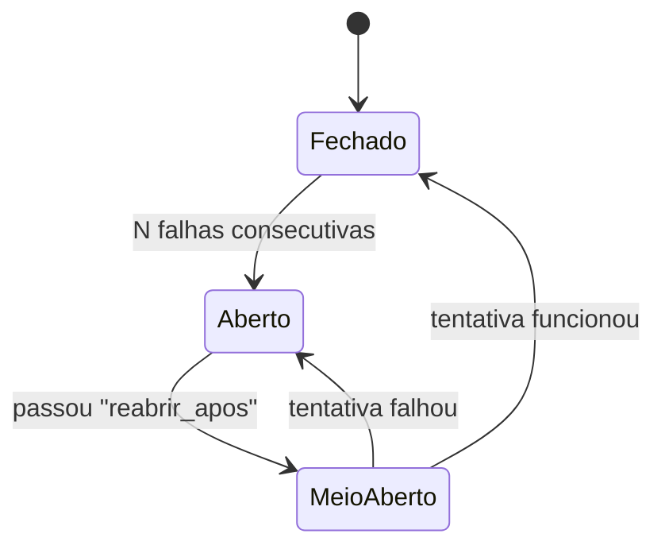

# Circuit Breaker

> "The basic idea behind the circuit breaker is very simple. You wrap a protected function
> call in a circuit breaker object, which monitors for failures. Once the failures reach a
> certain threshold, the circuit breaker trips, and all further calls to the circuit
> breaker return with an error, without the protected call being made at all."
> Martin Fowler, *Circuit Breaker*

| | |
|---|---|
| **Origem** | Michael Nygard, *Release It!* (2007); descrição de Martin Fowler (2014) |
| **Resolve** | Falha em cascata: chamadas a um fornecedor lento ou fora do ar esgotam threads, conexões e tempo do chamador |
| **Em uma frase** | Depois de N falhas, pare de chamar o fornecedor por um tempo, falhe rápido e teste a recuperação aos poucos |

## O problema

Em [`ruim.py`](ruim.py), cada requisição do usuário chama diretamente o fornecedor de
recomendações. Se ele está fora do ar, as 20 requisições do [teste](test_circuit_breaker.py)
insistem 20 vezes. Fowler descreve o efeito: chamadas remotas podem falhar ou ficar
penduradas até o timeout; com muitos chamadores sobre um fornecedor lento, os recursos
críticos se esgotam e a falha **se espalha**.

## A solução

Em [`bom.py`](bom.py), o `CircuitBreaker` envolve a chamada e tem três estados:

| Estado | Comportamento |
|---|---|
| **Fechado** | chama normalmente; conta falhas consecutivas; um sucesso zera a contagem |
| **Aberto** | rejeita na hora com `CircuitoAbertoError`, sem chamar o fornecedor; poupa quem está caído e libera o chamador |
| **Meio-aberto** | passado `reabrir_apos`, deixa uma tentativa passar; se funcionar, fecha, se falhar, reabre |

O teste usa um **relógio falso** (nada dorme) e prova: com limite 3, 20 chamadas
resultam em **3** idas ao fornecedor e 17 rejeições imediatas; abaixo do limite continua
fechado; um sucesso zera a contagem; em 29,9 s ainda está aberto e em 30 s meio-aberto; uma
tentativa meio-aberta que falha reabre o circuito por mais um período inteiro; e erros que
**não** são do fornecedor (um bug nosso) não abrem o circuito (`conta_como_falha`).

Fowler recomenda também **alertar quando o circuito abre**: é um sinal operacional de
primeira ordem (veja [observabilidade](../observabilidade/README.md)). E o que o chamador
faz com `CircuitoAbertoError`? Veja [degradação elegante](../degradacao-elegante/README.md).

## Quando não aplicar

- **Serviços internos de baixa carga ou chamadas isoladas.** Timeout e retry com backoff
  costumam bastar; o breaker adiciona estado e configuração para ajustar (limite, janela,
  o que conta como falha).
- **Falhas raras e independentes**, em que cada erro não prediz o próximo.
- **A AWS prefere outra ferramenta em alguns casos.** Em *Timeouts, retries, and backoff
  with jitter*, os autores dizem que circuit breakers "introduce modal behavior into systems
  that can be difficult to test" e podem aumentar o tempo de recuperação, e que mitigam o
  problema limitando retries localmente com um *token bucket*. São trade-offs, não uma
  regra única.
- **Este exemplo não é thread-safe** e ignora janelas deslizantes e taxas de erro. Em
  produção, use biblioteca madura (por exemplo, `pybreaker` ou `aiobreaker` em Python,
  `opossum` em Node.js) depois de conferir se já há uma no lockfile do projeto; não foram
  avaliadas aqui.

## Relações

- [Timeouts, retries e backoff](../timeouts-retries-backoff/README.md): o breaker é a
  camada acima, para de tentar quando as tentativas não resolvem.
- [Degradação elegante](../degradacao-elegante/README.md): o que fazer enquanto aberto.
- [Monólito × microsserviços](../../03-arquitetura/monolito-modular-vs-microsservicos/README.md):
  o breaker é parte do "prêmio" de chamar através da rede.

## Referências

- Martin Fowler, [*Circuit Breaker*](https://martinfowler.com/bliki/CircuitBreaker.html), 2014.
- Michael T. Nygard, *Release It! Design and Deploy Production-Ready Software*, Pragmatic Bookshelf, 2007.
- Marc Brooker, [*Timeouts, retries, and backoff with jitter*](https://aws.amazon.com/builders-library/timeouts-retries-and-backoff-with-jitter/), AWS Builders' Library, 2019.
